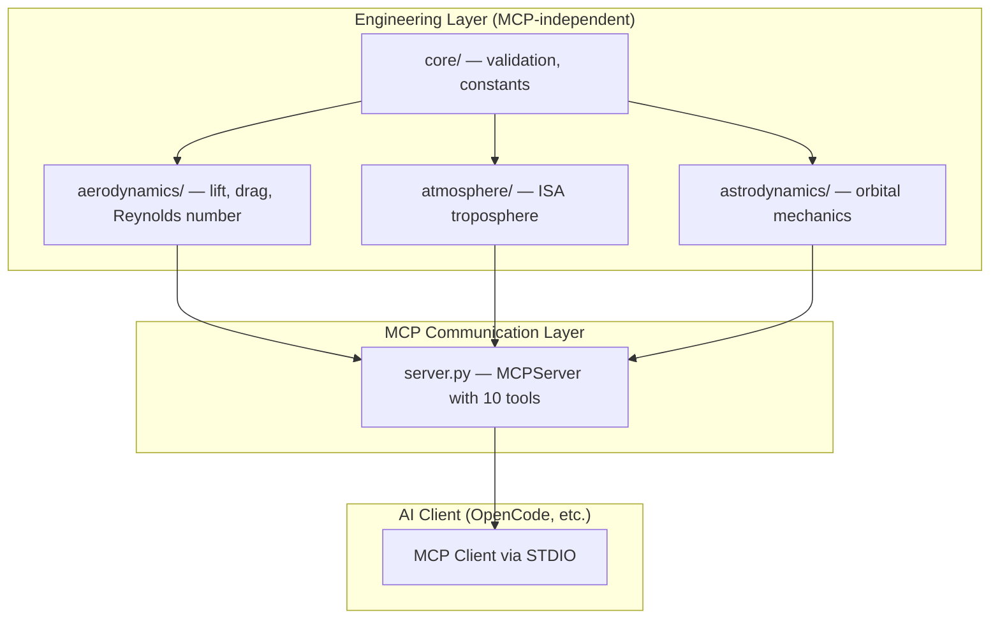

# AeroMCP

**Bringing Aerospace Engineering Computation to AI Agents.**

## Project Description

AeroMCP is an independent aerospace engineering computation library that exposes
validated engineering calculations through the Model Context Protocol (MCP). The
core engineering calculations are designed to work independently of any AI
application. MCP serves as an interface layer that makes these calculations
accessible as tools to compatible AI clients.

## Project Purpose

AeroMCP provides open, modular, validated aerospace engineering computation
functions that can be used directly in Python, independent of AI tooling. An MCP
server exposes these calculations as tools, enabling AI agents to invoke them
through the standardized Model Context Protocol.

## Feature Overview

### Implemented Features

| Feature | Description |
|---------|-------------|
| Dynamic pressure | Compute q = 0.5 × ρ × V² from air density and flow velocity |
| Lift force | Compute L = q × S × CL from density, velocity, area, and lift coefficient |
| Drag force | Compute D = q × S × CD from density, velocity, area, and drag coefficient |
| Lift coefficient | Compute CL = L / (q × S) from lift force, density, velocity, and area |
| Reynolds number | Compute Re = ρ × V × L / μ from flow and fluid properties |
| ISA troposphere | Compute temperature, pressure, density, speed of sound for geopotential altitudes 0–11000 m (1976 U.S. Standard Atmosphere) |
| MCP server | Ten registered tools exposing the above calculations via STDIO transport |

### Future Plans (Not Implemented)

- Compressible flow calculations (isentropic flow, shocks, expansion fans)
- Propulsion analysis (thrust, specific impulse, engine cycles)
- Multilayer ISA (stratosphere and above)
- HTTP/SSE transport for MCP server

## MCP Tools

The following ten tools are registered on the AeroMCP MCP server:

| Tool | Description | Output Unit |
|------|-------------|-------------|
| `calculate_dynamic_pressure` | Dynamic pressure from density and velocity | Pa |
| `calculate_lift_force` | Lift force from density, velocity, area, lift coefficient | N |
| `calculate_drag_force` | Drag force from density, velocity, area, drag coefficient | N |
| `calculate_lift_coefficient` | Dimensionless lift coefficient from lift force, density, velocity, area | dimensionless |
| `calculate_reynolds_number` | Dimensionless Reynolds number from flow properties | dimensionless |
| `calculate_isa_troposphere` | ISA tropospheric properties from geopotential altitude | K, Pa, kg/m³, m/s |
| `calculate_circular_orbital_velocity` | Circular orbital velocity from gravitational parameter and radius | m/s |
| `calculate_orbital_period` | Keplerian orbital period from gravitational parameter and semi-major axis | s |
| `calculate_escape_velocity` | Escape velocity from gravitational parameter and distance | m/s |
| `calculate_hohmann_transfer` | Hohmann transfer Delta-V budget and transfer time | structured |

## Architecture

AeroMCP follows a clean separation between engineering computation and MCP
communication:

- **Engineering layer** (`src/aeromcp/core/`, `aerodynamics/`, `atmosphere/`,
  `astrodynamics/`): Pure Python functions with no MCP dependency.
  Independently usable and testable.
- **MCP layer** (`src/aeromcp/server.py`): A thin interface that wraps
  engineering functions as MCP tools.



## Installation Instructions for Windows

### Prerequisites

- Python 3.11 or later (Python 3.12 recommended)

### Virtual Environment Setup

```powershell
# Create virtual environment
python -m venv .venv

# Activate virtual environment
.venv\Scripts\Activate.ps1
```

### Editable Development Installation

```powershell
# Install the package in editable mode with development dependencies
python -m pip install -e ".[dev]"
```

### OpenCode MCP Integration

Add the following to your `opencode.jsonc` configuration:

```jsonc
{
  "$schema": "https://opencode.ai/config.json",
  "mcp": {
    "servers": {
      "aeromcp": {
        "type": "local",
        "command": [
          "C:\\AeroMCP\\.venv\\Scripts\\python.exe",
          "-m",
          "aeromcp.server"
        ],
        "cwd": "C:\\AeroMCP",
        "codemode": false
      }
    }
  }
}
```

Replace `C:\\AeroMCP` with the actual path to your AeroMCP installation.

## Example Tool Calls

### Dynamic Pressure

```python
from aeromcp.aerodynamics import dynamic_pressure

q = dynamic_pressure(density_kg_m3=1.225, velocity_m_s=50.0)
# Result: 1531.25 Pa
```

### ISA Troposphere

```python
from aeromcp.atmosphere import isa_troposphere

props = isa_troposphere(geopotential_altitude_m=0.0)
# Result: temperature=288.15 K, pressure=101325 Pa,
#         density=1.225 kg/m³, speed_of_sound=340.294 m/s
```

### Via MCP Tool

```json
{
  "tool": "calculate_isa_troposphere",
  "arguments": {
    "geopotential_altitude_m": 5000
  }
}
```

### Circular Orbital Velocity

```python
from aeromcp.astrodynamics import circular_orbital_velocity

MU_EARTH = 3.986004418e14

v = circular_orbital_velocity(
    central_body_mu_m3_s2=MU_EARTH, orbital_radius_m=7_000_000.0
)
# Result: 7546.05 m/s
```

### Orbital Period

```python
from aeromcp.astrodynamics import orbital_period

MU_EARTH = 3.986004418e14

T = orbital_period(central_body_mu_m3_s2=MU_EARTH, semi_major_axis_m=7_000_000.0)
# Result: 5828.52 s
```

### Escape Velocity

```python
from aeromcp.astrodynamics import escape_velocity

MU_EARTH = 3.986004418e14

v_esc = escape_velocity(
    central_body_mu_m3_s2=MU_EARTH, distance_from_center_m=7_000_000.0
)
# Result: 10671.73 m/s
```

### Hohmann Transfer

```python
from aeromcp.astrodynamics import hohmann_transfer

MU_EARTH = 3.986004418e14

result = hohmann_transfer(
    central_body_mu_m3_s2=MU_EARTH,
    initial_orbit_radius_m=7_000_000.0,
    final_orbit_radius_m=42_164_000.0,
)
# Result: total Delta-V ≈ 3770.73 m/s, transfer time ≈ 19178.15 s
```


## Engineering Equations

| Calculation | Equation | SI Units |
|-------------|----------|----------|
| Dynamic pressure | q = 0.5 × ρ × V² | Pa |
| Lift force | L = q × S × CL | N |
| Drag force | D = q × S × CD | N |
| Lift coefficient | CL = L / (q × S) | dimensionless |
| Reynolds number | Re = ρ × V × L / μ | dimensionless |
| ISA temperature | T = T₀ − L × H | K |
| ISA pressure | P = P₀ × (T/T₀)^(g₀/(R×L)) | Pa |
| ISA density | ρ = P / (R × T) | kg/m³ |
| ISA speed of sound | a = √(γ × R × T) | m/s |
| Circular orbital velocity | v = √(μ / r) | m/s |
| Orbital period | T = 2π × √(a³ / μ) | s |
| Escape velocity | v_escape = √(2 × μ / r) | m/s |
| Hohmann transfer | a_t = (r1 + r2) / 2, dv_total = dv1 + dv2 | m/s, s |

## ISA Model Scope and Assumptions

- **Model:** 1976 U.S. Standard Atmosphere, tropospheric layer only
- **Valid altitude range:** 0 to 11000 metres (geopotential altitude)
- **Input:** Geopotential altitude (not geometric altitude)
- **Assumptions:** Dry air, hydrostatic equilibrium, ideal gas behaviour,
  constant gravitational acceleration, constant specific gas constant,
  constant ratio of specific heats

## Astrodynamics Model Scope and Assumptions

- **Model:** Two-body impulsive orbital mechanics
- **Gravitational parameter:** Supplied by the caller as μ = G × M
  (no central-body database or Earth-specific constants hardcoded)
- **Input units:** Orbital radius and distance measured from the central
  body's centre (not from its surface)
- **Output units:** SI units (m/s for velocity, s for period/time)
- **Assumptions:** Circular initial and final orbits, coplanar transfer,
  two instantaneous tangential burns, constant central-body gravitational
  parameter

### Earth Reference Example

| Parameter | Value |
|-----------|-------|
| Gravitational parameter (μ) | 3.986004418 × 10¹⁴ m³/s² |
| Initial orbit radius | 7,000,000 m |
| Final orbit radius | 42,164,000 m |
| Circular orbital velocity | 7546.05 m/s |
| Orbital period | 5828.52 s |
| Escape velocity | 10671.73 m/s |
| Hohmann total Delta-V | ≈ 3770.73 m/s |
| Hohmann transfer time | ≈ 19178.15 s |


## Testing

```powershell
# Run the full test suite
python -m pytest

# Run with verbose output
python -m pytest -v
```

### Test Coverage

| Test File | Tests |
|-----------|-------|
| tests/test_aerodynamics.py | 84 |
| tests/test_astrodynamics.py | 62 |
| tests/test_atmosphere.py | 15 |
| tests/test_package.py | 2 |
| tests/test_server.py | 27 |
| **Total** | **190** |

## Contribution Instructions

See [CONTRIBUTING.md](CONTRIBUTING.md) for local development setup, testing,
linting, branch conventions, and pull request guidelines.

See [SECURITY.md](SECURITY.md) for responsible vulnerability disclosure and
credential handling policies.

## Project Roadmap

The following items are planned for future releases:

1. **Atmosphere module** — ISA troposphere (complete)
2. **Aerodynamics module** — lift, drag, Reynolds number (complete)
3. **Astrodynamics module** — orbital mechanics (complete)
4. **MCP server** — ten registered tools (complete)
5. **Compressible flow module** — isentropic flow, shocks (planned)
6. **Propulsion module** — thrust, engine performance (planned)
7. **Packaging and release** — PyPI publication (planned)

## Technology Stack

- **Language:** Python 3.11+
- **Packaging:** setuptools with src-layout
- **MCP SDK:** mcp Python SDK v2 (`mcp>=2.3,<3`)
- **Testing:** pytest
- **Linting & Formatting:** ruff

## Limitations

- ISA implementation currently covers only 0–11000 m geopotential altitude
  (tropospheric layer only). Stratosphere and higher layers are not implemented.
- Orbital calculations use ideal two-body models. Atmospheric drag and
  perturbations are not modelled.
- Hohmann transfers use impulsive burns and assume circular, coplanar orbits.
- MCP currently uses local STDIO transport only. No remote HTTP deployment
  is implemented.
- AeroMCP is an engineering computation toolkit. It is **not** certified
  aircraft or spacecraft design software and should not be used for
  safety-critical aerospace applications without independent validation.

## Licence

AeroMCP is licensed under the MIT License. See [LICENSE](LICENSE) for details.
